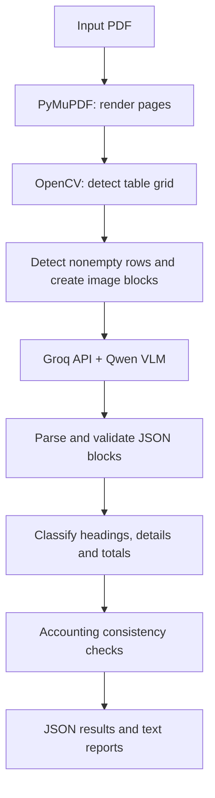
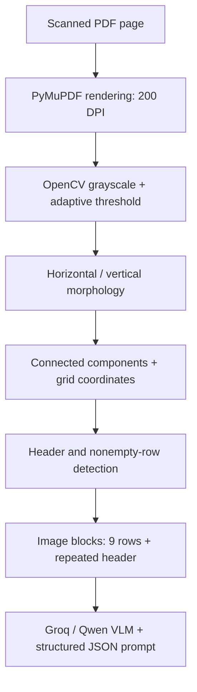

# Moroccan Financial Statements Extraction with VLMs

**Automated extraction of Moroccan balance sheets (ACTIF & PASSIF) using dynamic OpenCV table segmentation, Vision-Language Models (VLMs), and financial consistency checks.**

This academic project explores how to transform scanned Moroccan financial statements into structured, machine-readable JSON. It combines traditional computer vision for locating table rows with a vision-language model for reading accounting labels and amounts.

> **Project status:** Working prototype validated on a sample Moroccan balance sheet. Designed to handle variations in **gridded** layouts, but not yet guaranteed to work with every financial-statement format.

## Features

- **PDF processing:** render PDF pages as high-resolution images with PyMuPDF.
- **Dynamic table detection:** use OpenCV adaptive thresholding and morphological operations to detect horizontal and vertical grid lines without hardcoding the number of rows.
- **Row segmentation:** identify nonempty accounting rows, skip empty grid rows, and create manageable image blocks.
- **VLM-based extraction:** send each block to a Qwen vision-language model through the Groq API.
- **Structured outputs:** extract line descriptions and numerical values in a consistent ACTIF/PASSIF JSON schema.
- **Accounting post-processing:** classify headings, details, and totals; associate accounting sections with their lines where recognizable.
- **Financial validation:** compare extracted totals (I + II + III) against the general total and check ACTIF/PASSIF balance equality.
- **API-efficient processing:** cache model responses per PDF/block and automatically split blocks when the response format is invalid.
- **Debugging tools:** generate annotated pages, segmented images, and segmentation metadata for inspection.

## Processing pipeline



## Image preprocessing and dynamic table segmentation (OpenCV)

The image-processing stage is performed **before** sending any image to the VLM. Its objective is to isolate readable accounting rows while preserving the original alignment of labels and monetary columns. **OpenCV determines where to crop; the prompt determines how the VLM reads the resulting image.**

### Step 1 — Render PDF pages at 200 DPI

The input PDF is converted to RGB page images using **PyMuPDF**, then converted to OpenCV's BGR format. Each page is processed independently, so the document is not required to follow a fixed ACTIF/PASSIF page order.

```python
pix = page.get_pixmap(matrix=pymupdf.Matrix(200 / 72, 200 / 72), alpha=False)
image = np.frombuffer(pix.samples, np.uint8).reshape(pix.height, pix.width, 3).copy()
image = cv2.cvtColor(image, cv2.COLOR_RGB2BGR)
```

### Step 2 — Grayscale conversion and adaptive binarization

`detecter_grille()` converts the image to grayscale and uses **Gaussian adaptive thresholding** to create a binary mask. This separates dark text and table borders from the paper background, including where scan illumination is uneven.

```python
gray = cv2.cvtColor(image, cv2.COLOR_BGR2GRAY)
ink_mask = cv2.adaptiveThreshold(
    gray, 255,
    cv2.ADAPTIVE_THRESH_GAUSSIAN_C,
    cv2.THRESH_BINARY_INV,
    35, 13
)
```

This is a **detection mask**: the VLM still receives cropped regions of the original rendered image, rather than a degraded black-and-white transcription.

### Step 3 — Detect horizontal and vertical table lines

**Morphological opening** with horizontal and vertical structuring elements isolates the table rules. Kernel lengths scale with page dimensions instead of assuming a specific balance-sheet template.

```python
height, width = gray.shape

horizontal = cv2.morphologyEx(
    ink_mask, cv2.MORPH_OPEN,
    cv2.getStructuringElement(cv2.MORPH_RECT, (max(50, width // 7), 1))
)
vertical = cv2.morphologyEx(
    ink_mask, cv2.MORPH_OPEN,
    cv2.getStructuringElement(cv2.MORPH_RECT, (1, max(35, height // 8)))
)
```

The pipeline then uses `cv2.connectedComponentsWithStats()` to find sufficiently long line segments, merges nearby coordinates with `groupes_proches()`, and estimates the table boundaries and column separators.

Unlike the earlier template-specific version, it **does not require exactly 54 horizontal lines** or use predefined row indices. The geometric thresholds are still heuristics, however, and may need adjustments for very different or damaged layouts.

### Step 4 — Detect header rows and discard empty grid rows

The script estimates whether the table header occupies **one or two grid rows** by examining vertical separators. For each remaining row, it removes the detected grid lines from the binary mask and measures the amount of text-like ink in the **label column**.

- Rows with recognizable label content are kept, even when their monetary cells are empty.
- Entirely empty grid rows are skipped to avoid unnecessary VLM tokens.
- `--header-rows 1`, `2`, or `3` can override the header estimate when inspection reveals an error.

This stage preserves the original grid-row identifiers (`source_row`) so that each extracted JSON entry can be traced back to its image location.

### Step 5 — Build VLM-ready image blocks

`creer_bloc()` groups the retained rows into images of **nine rows by default** (`--rows 9`):

1. Crop the original table content, excluding the narrow vertical-letter margin when present.
2. Repeat the table's column headers at the top of **every** block.
3. Stack the selected row crops vertically, retaining the full horizontal alignment of label and amount columns.
4. Add each original grid-row number in a new left margin.
5. Save each block as a PNG for inspection and VLM inference.

**The script does not crop each financial cell separately.** Instead, the VLM reads a small, clearly numbered image that still displays all relevant columns together.



### Step 6 — Inspect the segmentation before using the API

Run **OpenCV-only preparation** first:

```bash
python analyse_image.py --pdf data/bilan_group_2.pdf --prepare-only
```

The generated artifacts let you inspect the preprocessing visually:

| Artifact | Purpose |
| --- | --- |
| `images/<pdf>_<hash>/page_01.png` | Original rendered page |
| `images/<pdf>_<hash>/page_01_debug.png` | Annotated table borders, detected lines, columns and row IDs |
| `outputs/<pdf>_<hash>/page_01/segmentation.json` | Table bounding box, grid coordinates, header rows and retained-row indices |
| `outputs/<pdf>_<hash>/page_01/blocs/*.png` | Final image blocks sent to the VLM |

On the initial **TALIANI AUTO** test PDF, the image-processing stage retained **51 ACTIF rows** (6 blocks) and **44 PASSIF rows** (5 blocks). These are observed results for that example, **not expected row counts enforced by the algorithm**.

> **Known limitations:** This approach targets financial tables with visible grid lines. Borderless layouts, multi-table pages, perspective distortions, rotated scans, merged cells, or severe noise may defeat the current morphology-based detector. The current script does not implement automatic deskewing or a trained table-detection model.

## Technology stack

| Tool | Role |
| --- | --- |
| Python | Main processing and orchestration |
| OpenCV | Grid detection, image preprocessing, and dynamic segmentation |
| NumPy | Image-array processing |
| PyMuPDF | PDF rendering |
| Groq API | Hosted VLM inference |
| Qwen VLM | Visual reading of accounting tables |
| Pillow | Image utilities |
| python-dotenv | Local API-key configuration |

## Project structure

```text
Moroccan-Financial-Statements-VLM/
├── analyse_image.py          # Main extraction pipeline
├── data/                     # Input PDFs (local files)
│   └── bilan_group_2.pdf     # Example filename
├── images/                   # Rendered and annotated pages (generated)
├── outputs/                  # JSON, blocks, caches and reports (generated)
├── .env                      # Local API key (DO NOT commit)
└── README.md
```

> If your main script is named `analyse_bilan_dynamique.py`, replace `analyse_image.py` in the commands below with that filename.

## Installation

**1. Clone or download the repository**, then open a terminal in the project directory.

**2. Create and activate a virtual environment** (Linux/macOS):

```bash
python3 -m venv vlmenv
source vlmenv/bin/activate
```

On Windows PowerShell:

```powershell
python -m venv vlmenv
.\vlmenv\Scripts\Activate.ps1
```

**3. Install the required packages:**

```bash
pip install -U opencv-python numpy pymupdf pillow groq python-dotenv
```

**4. Create a `.env` file** in the project root:

```dotenv
GROQ_API_KEY=your_groq_api_key_here
GROQ_MODEL=qwen/qwen3.8-27b
```

The model identifier is configurable; choose one that is available in your Groq account and supports image input.

**5. Place a financial-statement PDF** in `data/`.

## Usage

### 1. Test segmentation without API calls

```bash
python analyse_image.py --pdf data/bilan_group_2.pdf --prepare-only
```

This mode renders the PDF, detects grid lines, and generates image blocks **without calling Groq**. Check the annotated `page_XX_debug.png` images and the block images before running extraction.

### 2. Extract ACTIF and PASSIF when page order is known

```bash
python analyse_image.py --pdf data/bilan_group_2.pdf --types ACTIF,PASSIF
```

This avoids the VLM page-type classification call. **Note:** in the current implementation, supplying `--types` also skips the header-analysis call, so `entreprise` and `date_cloture` may remain `null`.

### 3. Automatically identify page types

```bash
python analyse_image.py --pdf data/bilan_group_2.pdf
```

The model examines page headers to classify pages as ACTIF, PASSIF, or OTHER and attempts to read metadata such as company name and closing date.

### 4. Test another balance sheet

```bash
python analyse_image.py --pdf data/another_balance_sheet.pdf --prepare-only
python analyse_image.py --pdf data/another_balance_sheet.pdf
```

### Useful command-line options

| Option | Purpose |
| --- | --- |
| `--pdf PATH` | Input PDF path |
| `--prepare-only` | Run OpenCV segmentation only; no API usage |
| `--types ACTIF,PASSIF` | Specify one document type per page |
| `--document ACTIF` | Process only ACTIF pages after classification |
| `--document PASSIF` | Process only PASSIF pages after classification |
| `--rows 9` | Maximum accounting rows per VLM image block (2–12) |
| `--header-rows 2` | Override the detected number of table header rows |
| `--max-tokens 800` | Set the model output-token budget (200–950) |

## Output files

Results are separated by PDF filename and a content fingerprint to prevent accidentally mixing data from different documents.

```text
outputs/
└── bilan_group_2_<hash>/
    ├── actif_page_1.json
    ├── passif_page_2.json
    ├── controle_actif_page_1.txt
    ├── controle_passif_page_2.txt
    ├── controle_actif_passif.txt
    ├── page_01/
    │   ├── segmentation.json
    │   ├── blocs/
    │   └── cache/
    └── page_02/
        ├── segmentation.json
        ├── blocs/
        └── cache/
```

Rendered pages and annotated grid-detection previews are stored separately under `images/<pdf_name>_<hash>/`.

### Example JSON — ACTIF

```json
{
  "source_page": 1,
  "source_row": 15,
  "poste": "* Matériel de transport",
  "rubrique": "C",
  "type_ligne": "detail",
  "brut": 6381126.16,
  "amortissements_provisions": 1972834.33,
  "net_N": 4408291.83,
  "net_N_1": 5684516.83
}
```

### Example JSON — PASSIF

```json
{
  "source_page": 2,
  "source_row": 2,
  "poste": "* Capital social ou personnel (1)",
  "rubrique": "A",
  "type_ligne": "detail",
  "net_N": 100000.0,
  "net_N_1": 100000.0
}
```

A `null` amount denotes a blank or unread value; it should **not** automatically be interpreted as a confirmed zero.

## Financial checks

The pipeline looks for accounting total lines by their labels rather than fixed row indices and checks:

- Section totals **I + II + III = TOTAL GÉNÉRAL**, where the required values are available.
- **ACTIF net N = PASSIF net N**.
- **ACTIF net N-1 = PASSIF net N-1**.

Validation reports show `OK`, `ECART`, or `INCOMPLET`, depending on the calculation and the availability of values. For genuinely blank cells, some calculations may treat a missing contribution as zero **only during validation**, while preserving `null` in the extracted JSON.

**Important:** balanced totals are necessary checks, but do not prove that every individual label or cell was read correctly.

## Limitations and future work

- The OpenCV segmentation is currently best suited to **tables with visible grid lines**. Borderless tables, skewed scans, merged cells, multiple side-by-side tables, and poor-quality scans may require further handling.
- OCR/VLM output can contain transcription errors or misplaced amounts; verify important records against the source PDF.
- Accounting rubric recognition may need additional reference-label normalization and validation for new layouts.
- The `--types` shortcut does not currently extract company metadata.
- Groq rate limits may interrupt extraction. Successfully cached blocks can be reused when the command is run again.
- Wider generalization should be evaluated on an independent collection of Moroccan balance sheets with different layouts.

Potential improvements include deskewing, table-layout models for borderless documents, more robust rubric matching, cell-level confidence indicators, and benchmark evaluation across multiple document templates.

## Collaboration

Contributions are welcome. Collaborators can create a feature branch, commit their changes, and open a pull request for review.

```bash
git checkout -b feature/your-feature-name
git add .
git commit -m "Describe your change"
git push -u origin feature/your-feature-name
```

## Security and data privacy

- **Never commit** `.env` files, API keys, or other credentials.
- Avoid committing real financial documents or extracted financial data without permission.
- Add `vlmenv/`, `.env`, `outputs/`, `images/`, `__pycache__/`, and other generated files to `.gitignore` as appropriate.
- Input images are sent to an external VLM API during extraction; only submit documents you are authorized to process.

## Project context

Developed as an academic experiment in **document understanding, computer vision, and Vision-Language Models**, focused on Moroccan ACTIF/PASSIF financial statements.
