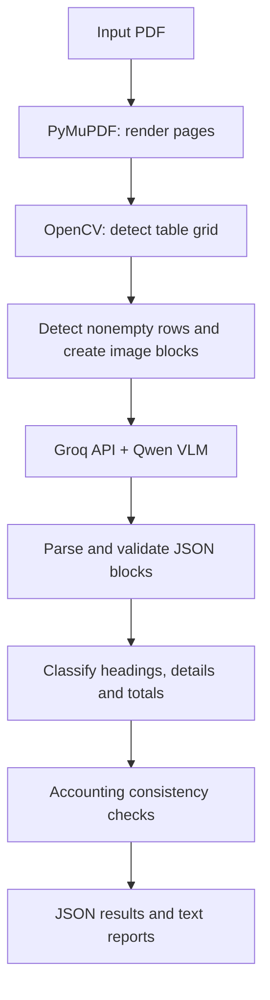
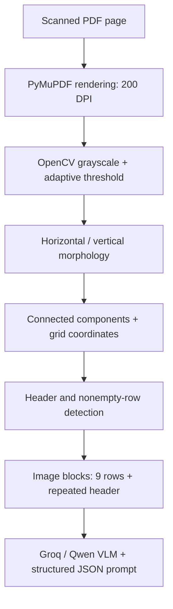
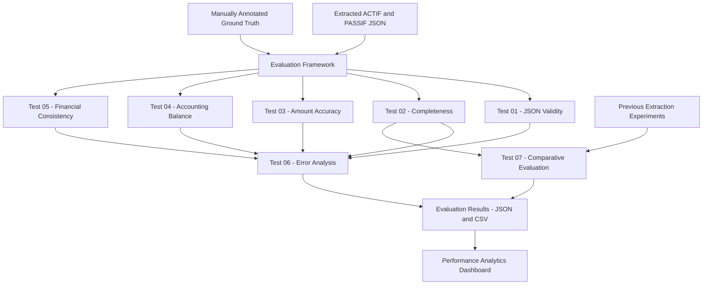
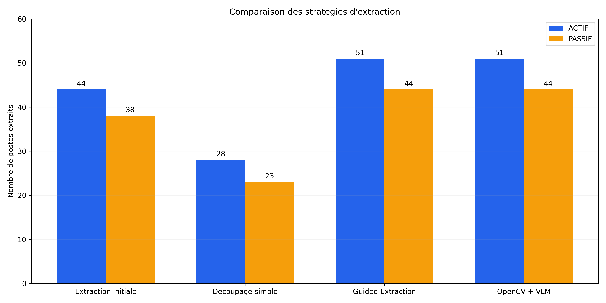
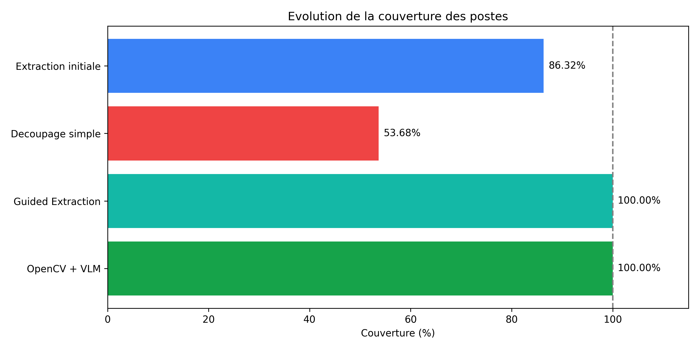
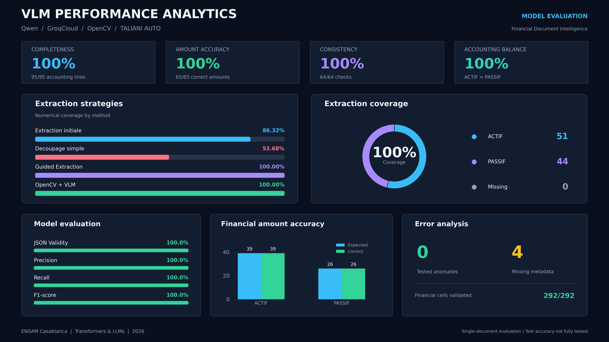

# Moroccan Financial Statements Extraction with VLMs

**Automated extraction of Moroccan balance sheets (ACTIF & PASSIF) using dynamic OpenCV table segmentation, Vision-Language Models (VLMs), and financial consistency checks.**

This academic project explores how to transform scanned Moroccan financial statements into structured, machine-readable JSON. It combines traditional computer vision for locating table rows with a vision-language model for reading accounting labels and amounts.

> **Project status:** Working prototype validated on a sample Moroccan balance sheet. Designed to handle variations in **gridded** layouts, but not yet guaranteed to work with every financial-statement format.

## Features

- **PDF processing:** render PDF pages as high-resolution images with PyMuPDF.
- **Dynamic table detection:** use OpenCV adaptive thresholding and morphological operations to detect horizontal and vertical grid lines without hardcoding the number of rows.
- **Row segmentation:** identify nonempty accounting rows, skip empty grid rows, and create manageable image blocks.
- **VLM-based extraction:** send each block to a Qwen vision-language model through the Groq API.
- **Structured outputs:** extract line descriptions and numerical values in a consistent ACTIF/PASSIF JSON schema.
- **Accounting post-processing:** classify headings, details, and totals; associate accounting sections with their lines where recognizable.
- **Financial validation:** compare extracted totals (I + II + III) against the general total and check ACTIF/PASSIF balance equality.
- **API-efficient processing:** cache model responses per PDF/block and automatically split blocks when the response format is invalid.
- **Debugging tools:** generate annotated pages, segmented images, and segmentation metadata for inspection.

## Processing pipeline



## Image preprocessing and dynamic table segmentation (OpenCV)

The image-processing stage is performed **before** sending any image to the VLM. Its objective is to isolate readable accounting rows while preserving the original alignment of labels and monetary columns. **OpenCV determines where to crop; the prompt determines how the VLM reads the resulting image.**

### Step 1 — Render PDF pages at 200 DPI

The input PDF is converted to RGB page images using **PyMuPDF**, then converted to OpenCV's BGR format. Each page is processed independently, so the document is not required to follow a fixed ACTIF/PASSIF page order.

```python
pix = page.get_pixmap(matrix=pymupdf.Matrix(200 / 72, 200 / 72), alpha=False)
image = np.frombuffer(pix.samples, np.uint8).reshape(pix.height, pix.width, 3).copy()
image = cv2.cvtColor(image, cv2.COLOR_RGB2BGR)
```

### Step 2 — Grayscale conversion and adaptive binarization

`detecter_grille()` converts the image to grayscale and uses **Gaussian adaptive thresholding** to create a binary mask. This separates dark text and table borders from the paper background, including where scan illumination is uneven.

```python
gray = cv2.cvtColor(image, cv2.COLOR_BGR2GRAY)
ink_mask = cv2.adaptiveThreshold(
    gray, 255,
    cv2.ADAPTIVE_THRESH_GAUSSIAN_C,
    cv2.THRESH_BINARY_INV,
    35, 13
)
```

This is a **detection mask**: the VLM still receives cropped regions of the original rendered image, rather than a degraded black-and-white transcription.

### Step 3 — Detect horizontal and vertical table lines

**Morphological opening** with horizontal and vertical structuring elements isolates the table rules. Kernel lengths scale with page dimensions instead of assuming a specific balance-sheet template.

```python
height, width = gray.shape

horizontal = cv2.morphologyEx(
    ink_mask, cv2.MORPH_OPEN,
    cv2.getStructuringElement(cv2.MORPH_RECT, (max(50, width // 7), 1))
)
vertical = cv2.morphologyEx(
    ink_mask, cv2.MORPH_OPEN,
    cv2.getStructuringElement(cv2.MORPH_RECT, (1, max(35, height // 8)))
)
```

The pipeline then uses `cv2.connectedComponentsWithStats()` to find sufficiently long line segments, merges nearby coordinates with `groupes_proches()`, and estimates the table boundaries and column separators.

Unlike the earlier template-specific version, it **does not require exactly 54 horizontal lines** or use predefined row indices. The geometric thresholds are still heuristics, however, and may need adjustments for very different or damaged layouts.

### Step 4 — Detect header rows and discard empty grid rows

The script estimates whether the table header occupies **one or two grid rows** by examining vertical separators. For each remaining row, it removes the detected grid lines from the binary mask and measures the amount of text-like ink in the **label column**.

- Rows with recognizable label content are kept, even when their monetary cells are empty.
- Entirely empty grid rows are skipped to avoid unnecessary VLM tokens.
- `--header-rows 1`, `2`, or `3` can override the header estimate when inspection reveals an error.

This stage preserves the original grid-row identifiers (`source_row`) so that each extracted JSON entry can be traced back to its image location.

### Step 5 — Build VLM-ready image blocks

`creer_bloc()` groups the retained rows into images of **nine rows by default** (`--rows 9`):

1. Crop the original table content, excluding the narrow vertical-letter margin when present.
2. Repeat the table's column headers at the top of **every** block.
3. Stack the selected row crops vertically, retaining the full horizontal alignment of label and amount columns.
4. Add each original grid-row number in a new left margin.
5. Save each block as a PNG for inspection and VLM inference.

**The script does not crop each financial cell separately.** Instead, the VLM reads a small, clearly numbered image that still displays all relevant columns together.



### Step 6 — Inspect the segmentation before using the API

Run **OpenCV-only preparation** first:

```bash
python analyse_image.py --pdf data/bilan_group_2.pdf --prepare-only
```

The generated artifacts let you inspect the preprocessing visually:

| Artifact | Purpose |
| --- | --- |
| `images/<pdf>_<hash>/page_01.png` | Original rendered page |
| `images/<pdf>_<hash>/page_01_debug.png` | Annotated table borders, detected lines, columns and row IDs |
| `outputs/<pdf>_<hash>/page_01/segmentation.json` | Table bounding box, grid coordinates, header rows and retained-row indices |
| `outputs/<pdf>_<hash>/page_01/blocs/*.png` | Final image blocks sent to the VLM |

On the initial **TALIANI AUTO** test PDF, the image-processing stage retained **51 ACTIF rows** (6 blocks) and **44 PASSIF rows** (5 blocks). These are observed results for that example, **not expected row counts enforced by the algorithm**.

> **Known limitations:** This approach targets financial tables with visible grid lines. Borderless layouts, multi-table pages, perspective distortions, rotated scans, merged cells, or severe noise may defeat the current morphology-based detector. The current script does not implement automatic deskewing or a trained table-detection model.

## Technology stack

| Tool | Role |
| --- | --- |
| Python | Main processing and orchestration |
| OpenCV | Grid detection, image preprocessing, and dynamic segmentation |
| NumPy | Image-array processing |
| PyMuPDF | PDF rendering |
| Groq API | Hosted VLM inference |
| Qwen VLM | Visual reading of accounting tables |
| Pillow | Image utilities |
| python-dotenv | Local API-key configuration |

## Project structure

```text
Moroccan-Financial-Statements-VLM/
├── analyse_image.py          # Main extraction pipeline
├── data/                     # Input PDFs (local files)
│   └── bilan_group_2.pdf     # Example filename
├── images/                   # Rendered and annotated pages (generated)
├── outputs/                  # JSON, blocks, caches and reports (generated)
├── .env                      # Local API key (DO NOT commit)
└── README.md
```

> If your main script is named `analyse_bilan_dynamique.py`, replace `analyse_image.py` in the commands below with that filename.

## Installation

### Upload interface using the notebook model

The local web interface uses **Qwen/Qwen2.5-VL-7B-Instruct** with 4-bit quantization, the ACTIF **V7** prompt, and the PASSIF **V13** prompt. It reads both prompt functions and group names directly from `Local/Local_extraction.ipynb`, so the notebook remains the source of truth. This interface does not use the Groq API or need `GROQ_API_KEY`.

Use a Python environment with a CUDA-capable GPU and a CUDA-enabled PyTorch installation. Then install the interface dependencies and start Streamlit:

```bash
pip install -r requirements-app.txt
streamlit run app.py
```

Open the local address printed by Streamlit. Upload a gridded Moroccan balance-sheet PDF, assign each page as ACTIF, PASSIF, or Skip, and click **Prepare group images**. Review the previews, then click **Run notebook model**. You can also upload one already-prepared group PNG/JPG and select its group. The result is downloadable JSON (or a ZIP for multiple pages).

Uploaded files are saved under `local_uploads/files/`. App screenshots can be kept under `local_uploads/screenshots/`. The entire `local_uploads/` folder is excluded by `.gitignore`.

For PDF input, the notebook group layout requires 53 detected ACTIF source rows (the first two are outside the 51 extracted group rows) or 44 PASSIF rows. If detection does not match, the interface shows an error instead of assigning financial values to possibly incorrect rows. Scans without clear table borders need different preprocessing. The first model run may download several gigabytes of weights.

The command-line `analyse_image.py` workflow described below is a separate Groq-based prototype.

**1. Clone or download the repository**, then open a terminal in the project directory.

**2. Create and activate a virtual environment** (Linux/macOS):

```bash
python3 -m venv vlmenv
source vlmenv/bin/activate
```

On Windows PowerShell:

```powershell
python -m venv vlmenv
.\vlmenv\Scripts\Activate.ps1
```

**3. Install the required packages:**

```bash
pip install -U opencv-python numpy pymupdf pillow groq python-dotenv
```

**4. Create a `.env` file** in the project root:

```dotenv
GROQ_API_KEY=your_groq_api_key_here
GROQ_MODEL=qwen/qwen3.8-27b
```

The model identifier is configurable; choose one that is available in your Groq account and supports image input.

**5. Place a financial-statement PDF** in `data/`.

## Usage

### 1. Test segmentation without API calls

```bash
python analyse_image.py --pdf data/bilan_group_2.pdf --prepare-only
```

This mode renders the PDF, detects grid lines, and generates image blocks **without calling Groq**. Check the annotated `page_XX_debug.png` images and the block images before running extraction.

### 2. Extract ACTIF and PASSIF when page order is known

```bash
python analyse_image.py --pdf data/bilan_group_2.pdf --types ACTIF,PASSIF
```

This avoids the VLM page-type classification call. **Note:** in the current implementation, supplying `--types` also skips the header-analysis call, so `entreprise` and `date_cloture` may remain `null`.

### 3. Automatically identify page types

```bash
python analyse_image.py --pdf data/bilan_group_2.pdf
```

The model examines page headers to classify pages as ACTIF, PASSIF, or OTHER and attempts to read metadata such as company name and closing date.

### 4. Test another balance sheet

```bash
python analyse_image.py --pdf data/another_balance_sheet.pdf --prepare-only
python analyse_image.py --pdf data/another_balance_sheet.pdf
```

### Useful command-line options

| Option | Purpose |
| --- | --- |
| `--pdf PATH` | Input PDF path |
| `--prepare-only` | Run OpenCV segmentation only; no API usage |
| `--types ACTIF,PASSIF` | Specify one document type per page |
| `--document ACTIF` | Process only ACTIF pages after classification |
| `--document PASSIF` | Process only PASSIF pages after classification |
| `--rows 9` | Maximum accounting rows per VLM image block (2–12) |
| `--header-rows 2` | Override the detected number of table header rows |
| `--max-tokens 800` | Set the model output-token budget (200–950) |

## Output files

Results are separated by PDF filename and a content fingerprint to prevent accidentally mixing data from different documents.

```text
outputs/
└── bilan_group_2_<hash>/
    ├── actif_page_1.json
    ├── passif_page_2.json
    ├── controle_actif_page_1.txt
    ├── controle_passif_page_2.txt
    ├── controle_actif_passif.txt
    ├── page_01/
    │   ├── segmentation.json
    │   ├── blocs/
    │   └── cache/
    └── page_02/
        ├── segmentation.json
        ├── blocs/
        └── cache/
```

Rendered pages and annotated grid-detection previews are stored separately under `images/<pdf_name>_<hash>/`.

### Example JSON — ACTIF

```json
{
  "source_page": 1,
  "source_row": 15,
  "poste": "* Matériel de transport",
  "rubrique": "C",
  "type_ligne": "detail",
  "brut": 6381126.16,
  "amortissements_provisions": 1972834.33,
  "net_N": 4408291.83,
  "net_N_1": 5684516.83
}
```

### Example JSON — PASSIF

```json
{
  "source_page": 2,
  "source_row": 2,
  "poste": "* Capital social ou personnel (1)",
  "rubrique": "A",
  "type_ligne": "detail",
  "net_N": 100000.0,
  "net_N_1": 100000.0
}
```

A `null` amount denotes a blank or unread value; it should **not** automatically be interpreted as a confirmed zero.

## Financial checks

The pipeline looks for accounting total lines by their labels rather than fixed row indices and checks:

- Section totals **I + II + III = TOTAL GÉNÉRAL**, where the required values are available.
- **ACTIF net N = PASSIF net N**.
- **ACTIF net N-1 = PASSIF net N-1**.

Validation reports show `OK`, `ECART`, or `INCOMPLET`, depending on the calculation and the availability of values. For genuinely blank cells, some calculations may treat a missing contribution as zero **only during validation**, while preserving `null` in the extracted JSON.

**Important:** balanced totals are necessary checks, but do not prove that every individual label or cell was read correctly.

---

## Evaluation Framework and Performance Dashboard

An independent evaluation framework was developed to assess the reliability, completeness, numerical accuracy, and accounting consistency of the extracted financial statements.

The evaluation operates directly on the generated ACTIF and PASSIF JSON files and does not require additional VLM inference or Groq API calls.

### Evaluation objectives

- Validate JSON syntax and schema compliance.
- Measure accounting row detection completeness.
- Calculate Precision, Recall, and F1-score.
- Compare extracted financial amounts against manually annotated ground truth.
- Verify accounting balance equality.
- Validate internal financial consistency.
- Identify extraction errors and missing information.
- Compare different extraction strategies.
- Centralize evaluation results in a single-screen analytics dashboard.

### Evaluation architecture



### Evaluation dataset

The evaluation was conducted on the **TALIANI AUTO** Moroccan balance sheet, consisting of two financial statement pages: ACTIF and PASSIF.

A manually prepared reference dataset was used to evaluate accounting row identifiers and numerical financial values.

| Dataset characteristic | Value |
| --- | ---: |
| Financial statements | 1 |
| PDF pages | 2 |
| ACTIF accounting rows | 51 |
| PASSIF accounting rows | 44 |
| Total accounting rows | 95 |
| ACTIF financial cells | 204 |
| PASSIF financial cells | 88 |
| Total financial cells | 292 |
| Nonempty financial amounts | 65 |
| Empty financial cells | 227 |

The ground truth includes monetary values and expected empty cells, allowing the evaluation to distinguish an actual extracted amount from an incorrectly generated value.

### Evaluation structure

```text
evaluation/
├── ground_truth/
│   └── amounts.json
│
├── results/
│   ├── test_01_json.json
│   ├── test_02_completeness.json
│   ├── test_03_accuracy.json
│   ├── test_04_balance.json
│   ├── test_05_consistency.json
│   ├── test_06_errors.json
│   ├── test_07_comparison.json
│   └── test_07_comparison.csv
│
├── figures/
│   ├── comparison_methods.png
│   ├── coverage_comparison.png
│   ├── dashboard_final.png
│   └── dashboard_final.pdf
│
├── test_json.py
├── test_completeness.py
├── test_accuracy.py
├── test_balance.py
├── test_consistency.py
├── test_errors.py
├── test_comparison.py
└── app.py
```

### Evaluation technology stack

| Technology | Purpose |
| --- | --- |
| Python | Evaluation scripts and orchestration |
| JSON Schema | Structured output validation |
| Pandas | Evaluation data processing |
| NumPy | Numerical operations |
| Matplotlib | Charts and performance dashboard |
| Ground Truth Annotation | Reference data for extraction evaluation |

### Test 01 — JSON Validity

**Script:** `evaluation/test_json.py`

This test verifies that the extracted ACTIF and PASSIF files contain valid JSON and respect the expected schema.

The validation includes:

- JSON syntax.
- Required fields.
- Financial data types.
- Accounting row structure.
- Schema compliance.

| Document | JSON Valid | Schema Valid | Errors |
| --- | --- | --- | ---: |
| ACTIF | Yes | Yes | 0 |
| PASSIF | Yes | Yes | 0 |

**Result: 100% JSON and schema validity.**

### Test 02 — Completeness Evaluation

**Script:** `evaluation/test_completeness.py`

This test compares the extracted accounting row identifiers with the expected row identifiers from the source document.

The following evaluation metrics are calculated:

- **True Positive (TP):** an expected accounting row that was successfully extracted.
- **False Positive (FP):** an extracted row that was not expected.
- **False Negative (FN):** an expected row that was not extracted.

The main metrics are:

$$
Precision = \frac{TP}{TP + FP}
$$

$$
Recall = \frac{TP}{TP + FN}
$$

$$
F1 = 2 \times \frac{Precision \times Recall}{Precision + Recall}
$$

#### Results

| Document | Expected | Extracted | TP | FP | FN |
| --- | ---: | ---: | ---: | ---: | ---: |
| ACTIF | 51 | 51 | 51 | 0 | 0 |
| PASSIF | 44 | 44 | 44 | 0 | 0 |
| **Total** | **95** | **95** | **95** | **0** | **0** |

| Metric | ACTIF | PASSIF | Global |
| --- | ---: | ---: | ---: |
| Precision | 100% | 100% | 100% |
| Recall | 100% | 100% | 100% |
| F1-score | 100% | 100% | 100% |

No missing accounting rows, unexpected rows, or duplicate identifiers were detected.

This test measures row-level completeness, not the exact transcription of accounting labels.

### Test 03 — Financial Amount Accuracy

**Script:** `evaluation/test_accuracy.py`

The extracted financial values are compared with manually annotated ground truth.

The evaluation covers:

- Gross amounts (`brut`).
- Depreciation and provisions (`amortissements_provisions`).
- Current-year net amounts (`net_N`).
- Previous-year net amounts (`net_N_1`).
- Expected empty financial cells.

Numerical accuracy is calculated as:

$$
Accuracy = \frac{Correctly\ Extracted\ Values}{Total\ Reference\ Values} \times 100
$$

#### Cell-level accuracy

| Document | Tested Cells | Correct Cells | Incorrect Cells | Accuracy |
| --- | ---: | ---: | ---: | ---: |
| ACTIF | 204 | 204 | 0 | 100% |
| PASSIF | 88 | 88 | 0 | 100% |
| **Total** | **292** | **292** | **0** | **100%** |

#### Nonempty financial amount accuracy

| Document | Expected Amounts | Correct Amounts | Accuracy |
| --- | ---: | ---: | ---: |
| ACTIF | 39 | 39 | 100% |
| PASSIF | 26 | 26 | 100% |
| **Total** | **65** | **65** | **100%** |

Separating nonempty financial amounts from blank cells prevents empty-cell accuracy from masking numerical extraction errors.

### Test 04 — Accounting Balance Validation

**Script:** `evaluation/test_balance.py`

This test verifies the fundamental accounting equality:

$$
Total\ ACTIF = Total\ PASSIF
$$

The verification is performed independently for the current and previous financial periods.

| Financial period | Total ACTIF | Total PASSIF | Difference | Status |
| --- | ---: | ---: | ---: | --- |
| N | 5,375,489.44 | 5,375,489.44 | 0.00 | PASS |
| N-1 | 6,435,224.86 | 6,435,224.86 | 0.00 | PASS |

**Result: 2/2 accounting balance checks passed.**

### Test 05 — Financial Consistency

**Script:** `evaluation/test_consistency.py`

This test verifies the internal arithmetic consistency of the extracted financial statements.

The implemented controls include:

- Global accounting totals.
- Summation of major accounting sections.
- Comparison of rubric totals with their detailed accounting contributions.
- Validation of the available ACTIF and PASSIF financial columns.

| Document | Controls | Passed | Failed |
| --- | ---: | ---: | ---: |
| ACTIF | 44 | 44 | 0 |
| PASSIF | 20 | 20 | 0 |
| **Total** | **64** | **64** | **0** |

**Financial consistency rate: 100%.**

These checks validate the implemented accounting relationships but do not represent an exhaustive financial audit.

### Test 06 — Error Analysis

**Script:** `evaluation/test_errors.py`

The error analysis aggregates the results generated by the previous evaluation scripts.

| Error category | Detected errors |
| --- | ---: |
| Structural errors | 0 |
| Missing accounting rows | 0 |
| Unexpected accounting rows | 0 |
| Duplicate rows | 0 |
| Financial amount errors | 0 |
| Accounting imbalances | 0 |
| Financial inconsistencies | 0 |
| **Total detected anomalies** | **0** |

#### Missing metadata

Four missing metadata entries were identified:

| Document | Missing field |
| --- | --- |
| ACTIF | `entreprise` |
| ACTIF | `date_cloture` |
| PASSIF | `entreprise` |
| PASSIF | `date_cloture` |

These missing values are expected because extraction was performed using the `--types ACTIF,PASSIF` option, which skips automated header analysis in the current implementation.

They are reported separately from the detected structural and numerical anomalies.

Some accounting labels may still contain minor transcription errors. Exhaustive textual accuracy was not measured.

### Test 07 — Comparative Evaluation

**Script:** `evaluation/test_comparison.py`

Several extraction strategies were explored during the development of the project.

#### Strategy 1 — Initial extraction

The complete financial statement page is directly submitted to the VLM.

#### Strategy 2 — Simple image cropping

The financial statement is divided into smaller image regions before extraction.

#### Strategy 3 — Guided extraction

Accounting row labels are identified first, followed by guided numerical extraction using smaller groups of rows.

#### Strategy 4 — Dynamic OpenCV + VLM extraction

The final pipeline combines dynamic table detection, nonempty-row identification, repeated column headers, source-row identifiers, image blocks, and structured VLM extraction.

#### Comparative results

| Extraction method | ACTIF | PASSIF | Total Rows | Numerical Coverage |
| --- | ---: | ---: | ---: | ---: |
| Initial extraction | 44 | 38 | 82 | 86.32% |
| Simple cropping | 28 | 23 | 51 | 53.68% |
| Guided extraction | 51 | 44 | 95 | 100% |
| **OpenCV + VLM** | **51** | **44** | **95** | **100%** |

Numerical coverage is calculated as:

$$
Coverage = \frac{Number\ of\ Extracted\ Rows}{Number\ of\ Expected\ Rows} \times 100
$$

The final OpenCV + VLM method achieved an improvement of approximately **13.68 percentage points** in numerical row coverage compared with the initial extraction strategy.





> The comparison measures the number of extracted rows relative to the reference count. It does not establish equivalent numerical or textual accuracy across all strategies. Only the final OpenCV + VLM pipeline underwent the complete evaluation framework.

---

## Global Evaluation Results

The final extraction pipeline achieved the following results on the evaluated financial statement:

| Evaluation metric | Result |
| --- | ---: |
| JSON and Schema Validity | 100% |
| Precision | 100% |
| Recall | 100% |
| F1-score | 100% |
| Financial Amount Accuracy | 100% |
| Financial Cell Accuracy | 100% |
| Accounting Balance | 100% |
| Financial Consistency | 100% |
| Accounting Rows Detected | 95/95 |
| Correct Financial Amounts | 65/65 |
| Correct Financial Cells | 292/292 |
| Financial Consistency Checks | 64/64 |
| Accounting Balance Checks | 2/2 |
| Detected Structural and Numerical Anomalies | 0 |
| Missing Metadata Entries | 4 |

These results demonstrate the effectiveness of the proposed pipeline on the evaluated document, without establishing generalization to unseen financial statement layouts.

## VLM Performance Analytics Dashboard

A dedicated analytics dashboard was developed to centralize the results of the seven evaluation tests in a modern, single-screen interface.

The dashboard follows a **Power BI-inspired dark-mode design** and provides a fixed fullscreen visualization without vertical or horizontal scrolling.



### Dashboard components

- **KPI cards:** completeness, financial amount accuracy, financial consistency, and accounting balance.
- **Extraction strategies:** comparison of the four extraction approaches.
- **Extraction coverage:** distribution of ACTIF and PASSIF accounting rows.
- **Model evaluation:** JSON validity, Precision, Recall, and F1-score.
- **Financial amount accuracy:** expected versus correctly extracted amounts.
- **Error analysis:** detected anomalies, missing metadata, and validated financial cells.

The dashboard automatically loads the JSON evaluation reports and calculates its metrics without requiring additional API calls.

### Dashboard features

- Modern dark-mode interface.
- Fixed fullscreen display.
- Single-page layout.
- Automatic proportional resizing.
- No scrollbars or navigation menus.
- Dynamic loading of evaluation results.
- High-resolution PNG and PDF exports.

### Launch the dashboard

```bash
python evaluation/app.py
```

Press `ESC` to close the dashboard.

The generated dashboard files are saved in:

```text
evaluation/figures/dashboard_final.png
evaluation/figures/dashboard_final.pdf
```

## Running the Evaluation Framework

### 1. Install evaluation dependencies

```bash
pip install pandas numpy matplotlib jsonschema
```

### 2. Generate the extracted financial statements

```bash
python analyse_image.py --pdf data/bilan_group_2.pdf --types ACTIF,PASSIF
```

The evaluation scripts are configured for the original TALIANI AUTO sample and its generated output directory. Update the configured paths and reference data before evaluating another document.

### 3. Execute the seven evaluation tests

Run the following commands from the project root:

```bash
python evaluation/test_json.py

python evaluation/test_completeness.py

python evaluation/test_accuracy.py

python evaluation/test_balance.py

python evaluation/test_consistency.py

python evaluation/test_errors.py

python evaluation/test_comparison.py
```

The generated JSON and CSV reports are saved in:

```text
evaluation/results/
```

The generated comparison charts are saved in:

```text
evaluation/figures/
```

### 4. Launch the final dashboard

```bash
python evaluation/app.py
```

## Evaluation Limitations

Although the final pipeline achieved 100% on the measured evaluation metrics, several limitations must be considered:

- The evaluation was performed on a single Moroccan balance sheet.
- Generalization to unseen financial statement layouts has not been established.
- Exhaustive accounting label transcription accuracy was not measured.
- Company name and closing date extraction were skipped in the evaluated configuration.
- The comparative evaluation focuses on numerical row coverage rather than full extraction accuracy.
- API latency, token consumption, and inference cost were not systematically benchmarked across extraction strategies.
- The project uses pretrained VLM inference without model training or fine-tuning.
- Financial consistency checks do not guarantee that every extracted accounting label or amount is correct.

Future evaluation should include multiple financial statements, independent reference datasets, diverse scan qualities, textual similarity metrics, and systematic inference performance benchmarking.

---

## Limitations and future work

- The OpenCV segmentation is currently best suited to **tables with visible grid lines**. Borderless tables, skewed scans, merged cells, multiple side-by-side tables, and poor-quality scans may require further handling.
- OCR/VLM output can contain transcription errors or misplaced amounts; verify important records against the source PDF.
- Accounting rubric recognition may need additional reference-label normalization and validation for new layouts.
- The `--types` shortcut does not currently extract company metadata.
- Groq rate limits may interrupt extraction. Successfully cached blocks can be reused when the command is run again.
- Wider generalization should be evaluated on an independent collection of Moroccan balance sheets with different layouts.

Potential improvements include deskewing, table-layout models for borderless documents, more robust rubric matching, cell-level confidence indicators, and benchmark evaluation across multiple document templates.

## Collaboration

Contributions are welcome. Collaborators can create a feature branch, commit their changes, and open a pull request for review.

```bash
git checkout -b feature/your-feature-name
git add .
git commit -m "Describe your change"
git push -u origin feature/your-feature-name
```

## Security and data privacy

- **Never commit** `.env` files, API keys, or other credentials.
- Avoid committing real financial documents or extracted financial data without permission.
- Add `vlmenv/`, `.env`, `outputs/`, `images/`, `__pycache__/`, and other generated files to `.gitignore` as appropriate.
- Input images are sent to an external VLM API during extraction; only submit documents you are authorized to process.

## Project context

Developed as an academic experiment in **document understanding, computer vision, and Vision-Language Models**, focused on Moroccan ACTIF/PASSIF financial statements.
